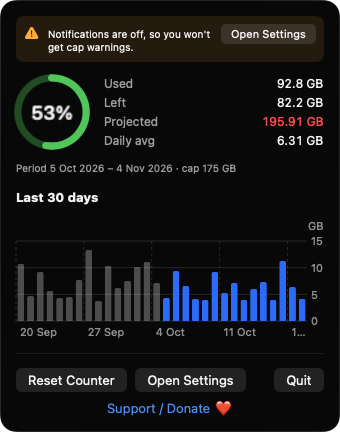
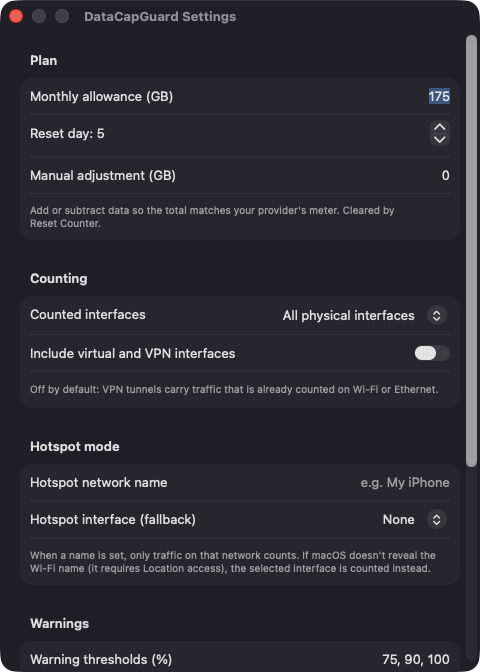
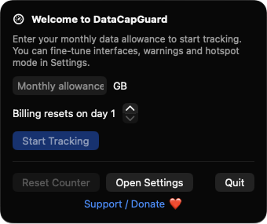

# DataCapGuard

**🌐 Website:** [turhe123.github.io/data-cap-guard](https://turhe123.github.io/data-cap-guard/)

Track monthly internet usage against your data cap with a menu bar gauge and warnings before you run out.

> 🆓 A free, open-source **PeakHour 4 alternative** for macOS 14+. Native Swift, no accounts, no subscriptions, MIT licensed.


## Why

DataCapGuard is a free, open-source, 100% native, backend-free alternative to paid utilities in the *System Monitoring* category. It was inspired by PeakHour 4 ($9.99 one-time), a great network monitor; DataCapGuard deliberately does one smaller thing: it tracks your usage against a monthly cap. Everything stays on your Mac: no accounts, no servers, no analytics.

## Features

- **Menu bar gauge**: a ring, a percentage, or both (configurable), colored to shift toward amber and red as usage grows.
- **Popover dashboard**: circular gauge plus Used, Left, Projected (turns red if it exceeds your cap) and Daily average, and the current billing period dates.
- **30-day bar chart** of daily usage built with Swift Charts; days in the current period are highlighted.
- **Setup wizard** on first launch asking only for your monthly allowance (GB) and billing reset day.
- **Billing reset day** (1–31); days beyond a month's length clamp to its last day. Changing it recomputes the period from stored daily data.
- **Counted interfaces**: all physical interfaces, Wi-Fi only, or Ethernet only. VPN and virtual interfaces (utun, bridge, awdl, etc.) are excluded by default to avoid double counting, with an opt-in toggle.
- **Hotspot mode**: enter a network name (e.g. your iPhone) and only traffic on that network counts. If macOS doesn't reveal the Wi-Fi name, a manually chosen interface is counted instead.
- **Configurable warnings**: notifications at thresholds you choose (default 75, 90, 100%), each fired once per period.
- **Manual adjustment** (GB) to line the total up with your provider's meter; **Reset Counter** zeroes the current period while keeping chart history.
- **Reliable counting**: samples interface byte counters every 5 seconds and right after wake, handles counter wrap and resets as a new baseline, and persists daily totals as JSON in Application Support so they survive reboots.
- **Launch at login** via `SMAppService`.
- Banners in the popover when notifications are turned off or hotspot mode isn't counting.

> **Accuracy note:** usage measured on this Mac can differ from your provider's billing. Use the manual adjustment field to compensate.

## Screenshots

<p align="center"></p>

<p align="center"><em>The menu bar popover shows a usage gauge, used/left/projected totals with the projection turning red when it would exceed the cap, and a 30-day chart highlighting the current billing period.</em></p>

<p align="center"></p>

<p align="center"><em>Settings let you set your monthly allowance, reset day, manual adjustment, counted interfaces, hotspot mode and warning thresholds.</em></p>

<p align="center"></p>

<p align="center"><em>On first launch a short setup wizard asks only for your monthly allowance and billing reset day.</em></p>

## Install

1. Download `DataCapGuard-macOS.zip` from the [latest release](https://github.com/turhe123/data-cap-guard/releases/latest).
2. Unzip it and move `DataCapGuard.app` to `/Applications`.
3. Because the app is open source and not notarized, clear the quarantine flag:

   ```bash
   xattr -cr /Applications/DataCapGuard.app
   ```

4. The first time, right-click the app and choose **Open**.

## Build from source

Requires macOS 14+ and Xcode with Swift 5.9+.

```bash
brew install xcodegen
xcodegen generate
xcodebuild -project DataCapGuard.xcodeproj -scheme DataCapGuard -configuration Release -derivedDataPath ./build build
```

The app is produced at `build/Build/Products/Release/DataCapGuard.app`.

## Permissions

DataCapGuard asks for very little. Based on the code:

- **Notifications**: requested on first launch so it can warn you at your thresholds. If you decline, the app still tracks usage and shows a banner.
- **Location (optional, system-controlled)**: macOS may hide the current Wi-Fi network name (read via CoreWLAN) unless Location access is granted. This only matters for Hotspot mode; without it, pick a hotspot interface in Settings instead.
- **Login item**: only if you enable *Launch at login*.

It does **not** request Accessibility, Screen Recording, or Microphone access. It reads only per-interface byte counters, never your traffic contents.

## Built with AI

DataCapGuard was written by [Claude Code](https://claude.com/claude-code) inside an automated pipeline, from a plain-English spec. No code, binaries or assets from any commercial app were used; it is a clean-room reimplementation of a feature set, not a copy.

What that means in practice:

- The full source is in this repo under the MIT license. Read it before you run it.
- No network calls, no analytics, no third-party dependencies. Only Apple frameworks.
- Ad-hoc signed and not notarized, which is why Gatekeeper warns on first launch.
- It has had less human review than a hand-written app. Bug reports and pull requests are welcome.

## Support ❤️

If DataCapGuard saves you from an overage bill, consider supporting development:

[Support Or (Leo) Davidai ❤️ on Ko-fi](https://ko-fi.com/leodavidai)

There is also a **Support / Donate ❤️** button in the app.

## More free Mac apps

DataCapGuard is one of a growing collection of [free, open-source Mac utilities](https://github.com/turhe123/mac-apps) built the same way: native Swift, no accounts, no telemetry. Browse the full gallery at [turhe123.github.io/mac-apps](https://turhe123.github.io/mac-apps/).

Prefer something that runs in the browser? The same pipeline builds [free, private web tools](https://turhe123.github.io/web-tools/): PDF, image, developer, data and audio tools, nothing uploaded.

## License

MIT © Or Davidai Bachar
